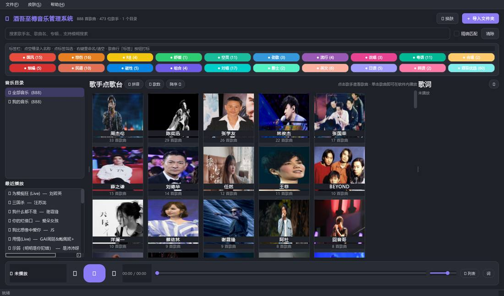
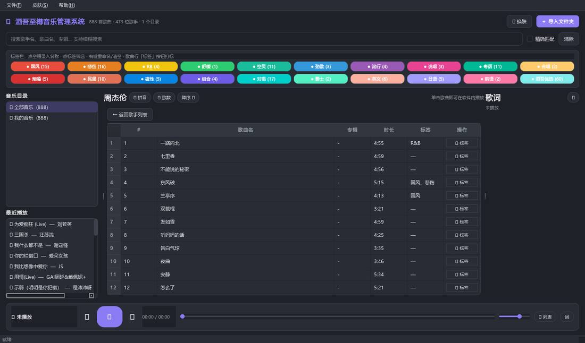
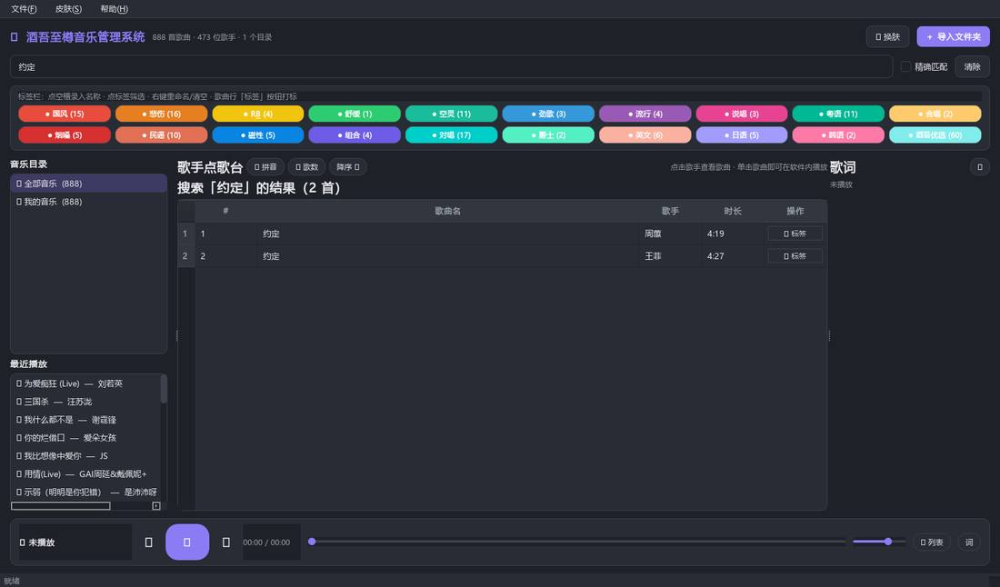
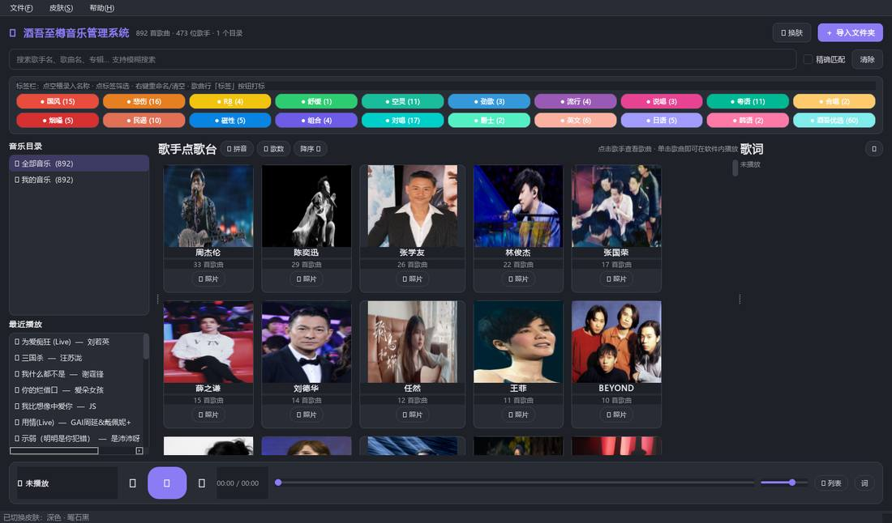

打开一个音乐软件，先看 5 秒开屏广告；好不容易进去，首页推的全是你不听的歌；想找一首电脑里存了好几年的老歌，得在层层菜单里翻半天。

你有没有这种感觉？

我自己电脑里有个音乐文件夹，800 多首歌，都是这些年一首一首攒下来的。它们不联网、不占会员、不会哪天突然下架。可偏偏，现在没有一个软件能让我舒舒服服地听这些**本地歌曲**。

市面上的播放器，要么广告缠身，要么把"本地音乐"当成一个不起眼的附属功能——你的收藏是它的流量入口，不是你的私人唱片架。

既然找不到顺手的，那就自己做一个。

于是有了这个东西：**酒吾至樽音乐管理系统**——一个只管你自己电脑里那些歌的私人点歌台。

## 一、它不是播放器，是"点歌台"

打开软件的第一眼，不是冷冰冰的文件列表，而是一整面**歌手照片墙**。

每位歌手一张卡，照片、名字、歌曲数一目了然。想听谁，点他的照片就行——像在 KTV 点歌一样，先选人，再选歌。

照片是软件按歌手名从网上自动抓取的真人照片，不用你自己一张张找。偶尔有冷门歌手没抓到，也能点一下手动上传，或者批量重新获取。

## 二、这些歌，是我一首一首攒下来的

软件的核心，就是把散落在硬盘各处的音乐整理得明明白白。

**导入一个文件夹就行。** 点右上角「导入文件夹」，选中你的音乐目录，它会递归扫描里面所有音频文件——mp3、flac、m4a、wma、ape、wav……自动读取歌曲标签，按歌手分好类。标签缺失的，还能从文件名和文件夹名推断。

**每次打开自动同步。** 你往文件夹里加了新歌，下次打开自动入库；你删掉的歌，软件里的记录也跟着清掉。不用再手动维护。

点开一位歌手，就是他的歌单，歌名、专辑、时长、标签排得整整齐齐。单击一首歌，直接在软件里播放——不用跳转系统播放器，也不用忍受任何贴片广告。

## 三、合唱的歌，三位歌手目录下都能找到

这是我自己比较满意的一个细节。

比如一首歌是「张杰;莫文蔚」合唱的，那它不会只待在一个地方——**张杰的目录、莫文蔚的目录、还有"张杰;莫文蔚"合作目录，三个地方都能找到它**。

分隔符 `;`、`、`、`/`、`&`、`，` 都认。再也不用纠结"这首歌到底该算谁的"。

## 四、搜歌名，直接给你歌曲；20 个标签随便打

搜索框支持歌名、歌手名、专辑、文件名模糊匹配，还能切精确匹配。

搜一个歌名，比如「约定」，它不会只丢给你几个歌手让你继续点——而是**直接把这首歌的列表摆出来**，点一下就能播。

另外有 **20 个标签槽**，名字自己定。像我给自己设了「国风」「悲伤」「粤语」「对唱」「酒吾优选」这些。给歌曲打上标签后，点标签就能一键筛出这一类，按歌名拼音排好序，找歌特别快。

右键还能手动改歌名、歌手、专辑——有些老文件的标签本来就是乱的，改完软件里的分类立刻跟着更新，磁盘上的原文件一个字都不动。

## 五、边听边看歌词，五种皮肤随手换

播放的时候，右侧歌词面板会**逐行高亮、自动滚动**。歌词优先读本地的 `.lrc` 和音频内嵌标签；本地没有的，会后台自动去公共歌词库 LRCLIB 补上，带缓存、不卡播放，也能一键关掉。

底部播放条该有的都有：播放/暂停、上一首下一首、进度拖动、音量、三种循环模式。播放队列就是你当前看的那个列表——在歌手页听，就顺着这位歌手听下去；在搜索结果里听，就顺着结果听下去。

左侧还有一个「最近播放」，按时间倒序记着你听过的歌，双击就能回放，记录存在本地，重启软件也不会丢。

皮肤嘛，内置五套：浅色雅致白、深色曜石黑、紫色梦幻紫、护眼薄荷绿、商务深蓝，点一下「换肤」循环切换，偏好会自动记住。

想更个性化？「皮肤」菜单里可以上传任意本地图片做背景，面板会自动半透明透出来，文字照样清楚。图片只存在你电脑里，不会上传。

## 写在最后

这个软件从导入、分类、打标、搜索，到播放、歌词、换肤，**全程都在你自己的电脑上跑**。你的音乐、你的照片、你的播放记录，都是本地数据，不上传、不联网也能用（除了可选的在线歌词）。

它现在安安静静地躺在我电脑里，管着我那 800 多首歌。没有广告，没有推荐算法，没有"猜你喜欢"。想听什么，点开，就是了。

如果你也有一堆存了很久、却不知道怎么好好听的本地歌曲，希望它能帮上忙。

软件体积比较大，就不直接传附件了。如果你想要，可以在公众号后台留言，或者发邮件给我（deanwoo@foxmail.com），我看到后发给你。

> **软件设计BY酒吾至樽deanwoo.cn**
